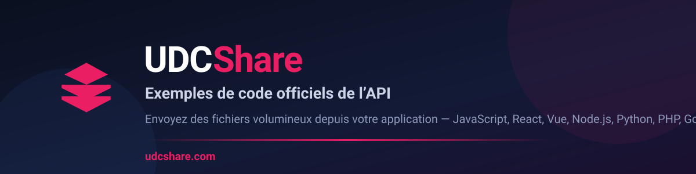

<p align="center">
  <a href="https://udcshare.com"></a>
</p>

<h1 align="center">Exemples de code officiels de l'API UDCShare</h1>

<p align="center">
  Envoyez des fichiers volumineux depuis votre application, en quelques lignes de code.<br>
  <strong>JavaScript · React · Vue · Node.js · Python · PHP · Go</strong>
</p>

<p align="center">
  <a href="https://udcshare.com"></a>
  <a href="https://udcshare.com/api/docs"></a>
  <a href="LICENSE"></a>
</p>

---

## Qu'est-ce que UDCShare ?

**[UDCShare](https://udcshare.com)** est un service de partage de fichiers volumineux pour les
particuliers, les étudiants et les professionnels. Vous connectez votre propre Google Drive :
vos fichiers restent chez vous, UDCShare se charge du lien, de l'expiration, du mot de passe,
des notifications et du suivi des téléchargements.

L'**API REST** permet d'intégrer tout cela dans votre propre application : votre produit SaaS,
votre intranet, votre script de sauvegarde ou votre site web.

| | |
|---|---|
| 🌐 **Site** | [udcshare.com](https://udcshare.com) |
| 📘 **Documentation interactive** | [udcshare.com/api/docs](https://udcshare.com/api/docs) |
| 🧪 **Exemples en ligne** | [udcshare.com/examples/](https://udcshare.com/examples/) |
| 🔑 **Obtenir une clé API** | [Tableau de bord → Développeur](https://udcshare.com/dashboard?tab=developer) |
| 📄 **Spécification OpenAPI 3.0** | [udcshare.com/api/openapi.json](https://udcshare.com/api/openapi.json) |
| 📦 **SDK JavaScript officiel** | [udcshare.com/sdk/udcshare-sdk.js](https://udcshare.com/sdk/udcshare-sdk.js) |

---

## Démarrer en une minute

Toutes les requêtes portent votre clé API dans l'en-tête **`X-API-Key`**
(et non `Authorization: Bearer`).

```bash
curl https://udcshare.com/api/v1/account \
  -H "X-API-Key: VOTRE_CLE_API"
```

```javascript
const r = await fetch('https://udcshare.com/api/v1/account', {
  headers: { 'X-API-Key': process.env.UDCSHARE_API_KEY },
});
const compte = await r.json();
```

> **Gardez la clé côté serveur.** Ne la placez jamais dans du code livré au navigateur
> ni dans un dépôt Git. Chaque exemple de ce dépôt lit la clé depuis une variable
> d'environnement et fournit un `.env.example`.

---

## Les exemples

Sept exemples contiennent du code source complet, commenté et prêt à adapter.
Chaque dossier a son propre `README.md`, son `.env.example` et ses dépendances.

### Côté navigateur et interfaces

| Langage | Exemple | Ce que vous obtenez |
|---|---|---|
| **JavaScript** | [`javascript-client/`](./javascript-client/) | Client autonome navigateur + Node.js, glisser-déposer, progression d'envoi, zéro dépendance |
| **React** | [`react-upload-component/`](./react-upload-component/) | Hook `useUDCShareUpload` : progression, annulation, gestion d'erreurs |
| **Vue 3** | [`vue-upload-component/`](./vue-upload-component/) | Composable `useUDCShare` pour la Composition API (compatible Nuxt) |

### Côté serveur

| Langage | Exemple | Ce que vous obtenez |
|---|---|---|
| **Node.js** | [`nodejs-upload-api/`](./nodejs-upload-api/) | API Express qui relaie les envois en gardant la clé côté serveur |
| **Python** | [`python-backup-system/`](./python-backup-system/) | Sauvegarde planifiée avec journalisation, SQLite et reprise sur erreur |
| **PHP 8** | [`php-upload-service/`](./php-upload-service/) | Classe `Client` compatible Composer, intégrable à Laravel ou Symfony |
| **Go 1.21+** | [`go-backup-service/`](./go-backup-service/) | Paquet `udcshare` et service de sauvegarde concurrent |

### En préparation

Les dossiers [`ruby-upload-gem/`](./ruby-upload-gem/) et
[`angular-upload-module/`](./angular-upload-module/) ne contiennent pour l'instant que
leur documentation et leur manifeste, **sans code source**. Leur README décrit l'intention,
pas un code livré. Les contributions sont bienvenues.

---

## Installation

```bash
git clone https://github.com/SALEMEDO/udcshare-api-examples.git
cd udcshare-api-examples/python-backup-system    # ou l'exemple de votre choix
cp .env.example .env                              # puis renseignez UDCSHARE_API_KEY
```

Les dépendances s'installent avec l'outil habituel du langage : `pip install -r requirements.txt`,
`npm install`, `composer install` ou `go mod download`. Le README de chaque dossier donne la
commande exacte et la façon de lancer l'exemple.

---

## Limites de l'API par formule

L'accès à l'API REST est inclus dans les formules **Essentials**, **Pro** et **Business**.
Ces valeurs viennent directement du catalogue de formules du produit.

<!-- PLAN_LIMITS:START -->
| Plan | Prix | Taille max par fichier web | Quota total par jour (UTC) | Limite par semaine (lundi 0 h, Kinshasa) | Quota web/mois | Envois/mois | Stockage | Drives | Uploads simultanés | Expiration lien (défaut; maximum) | Téléchargements/jour | Quotas API (taille/fichier; req/min/IP; fichiers/jour) |
|---|---:|---:|---:|---|---:|---:|---|---:|---:|---|---|---|
| Free | Gratuit | 2 Go | Non plafonné | 3 envois; 5 Go | 15 Go | 10 | Fourni par le Drive connecté | 1 | 1 | 1 jour (max. 7 jours) | Aucun plafond par plan | Non incluse |
| Essentials | 8 500 CDF | 10 Go | Non plafonné | 15 envois; 25 Go | 75 Go | 50 | Fourni par le Drive connecté | 3 | 1 | 7 jours (max. 30 jours) | Aucun plafond par plan | 5 Go; 100 req/min/IP; 50 fichiers/jour |
| Pro | 20 000 CDF | 100 Go | 100 Go | 30 envois; 250 Go | 750 Go | 100 | Fourni par le Drive connecté | 10 | 10 | 7 jours (max. 30 jours) | Aucun plafond par plan | 25 Go; 300 req/min/IP; 200 fichiers/jour |
| Business | 57 000 CDF | 1 To | Illimité | Aucune | 5 To | 1000 | Fourni par le Drive connecté | Selon configuration | 50 | Aucune expiration automatique (max. sans plafond) | Aucun plafond par plan | 1 To; 1000 req/min/IP; 1000 fichiers/jour |
<!-- PLAN_LIMITS:END -->

Les quotas API REST sont comptés par clé : taille par fichier, nombre de fichiers enregistrés
par jour UTC et débit par minute. Un dépassement renvoie un code `429`.
<details>
<summary>Politique détaillée par canal (web et API REST)</summary>

<!-- PLAN_CHANNEL_POLICIES:START -->
| Plan | Canal | Accès | Max par fichier | Quota total en octets/jour | Quota total en octets/mois | Transferts/mois | Uploads simultanés | Fichiers/jour | Requêtes/minute |
|---|---|---|---:|---:|---:|---:|---:|---:|---:|
| Guest | Web | Oui | 500 Mo | Aucun plafond | 500 Mo | 5 | 1 | — | — |
| Guest | API REST par clé | Non incluse | — | — | — | — | — | — | — |
| Free | Web | Oui | 2 Go | Aucun plafond | 15 Go | 10 | 1 | — | — |
| Free | API REST par clé | Non incluse | — | — | — | — | — | — | — |
| Essentials | Web | Oui | 10 Go | Aucun plafond | 75 Go | 50 | 1 | — | — |
| Essentials | API REST par clé | Oui | 5 Go | Non appliqué | Non appliqué | — | — | 50 (UTC) | 100/IP |
| Pro | Web | Oui | 100 Go | 100 Go (UTC) | 750 Go | 100 | 10 | — | — |
| Pro | API REST par clé | Oui | 25 Go | Non appliqué | Non appliqué | — | — | 200 (UTC) | 300/IP |
| Business | Web | Oui | 1 To | Aucun plafond | 5 To | 1000 | 50 | — | — |
| Business | API REST par clé | Oui | 1 To | Non appliqué | Non appliqué | — | — | 1000 (UTC) | 1000/IP |

Politique : les limites Web s’appliquent aux uploads de transfert Web ; les quotas en octets et le nombre de transferts mensuels sont cumulés par compte. Le quota journalier Web utilise la date UTC et se réinitialise à 00:00 UTC. Les quotas API REST v1 par clé sont indépendants : taille par fichier, nombre de fichiers enregistrés par jour UTC et débit par minute compté par clé API sur toutes les routes API limitées (30 clés invalides au plus par IP et par 15 minutes). Cette API n’a pas de plafond journalier ou mensuel en octets. Ses limites affichées comme « Non incluse » ne sont pas applicables aux plans sans accès API. Les endpoints de session `/api/transfers/*` et `/api/dashboard/reports/*` utilisent séparément un limiteur générique de 30 requêtes/minute/IP ; les autres endpoints d’application ne sont pas couverts par ce limiteur.
<!-- PLAN_CHANNEL_POLICIES:END -->

</details>

Tarifs et limites à jour : **[udcshare.com/pricing](https://udcshare.com/pricing)**.

---

## Support et contribution

- **Support technique** : [support@udcshare.com](mailto:support@udcshare.com)
- **Signaler un problème dans un exemple** :
  [ouvrir une issue](https://github.com/SALEMEDO/udcshare-api-examples/issues)
- **Proposer un exemple** : les pull requests sont bienvenues, voir
  [CONTRIBUTING.md](./CONTRIBUTING.md)

Ces exemples sont fournis **sous licence MIT** ([LICENSE](./LICENSE)) : utilisez-les, modifiez-les
et redistribuez-les librement, y compris dans un projet commercial. Vérifiez la gestion des
erreurs et des secrets avant une mise en production.

---

<p align="center">
  <a href="https://udcshare.com"></a>
</p>
<p align="center">
  <strong><a href="https://udcshare.com">UDCShare</a></strong> — partagez vos gros fichiers, gardez vos données chez vous.
</p>
