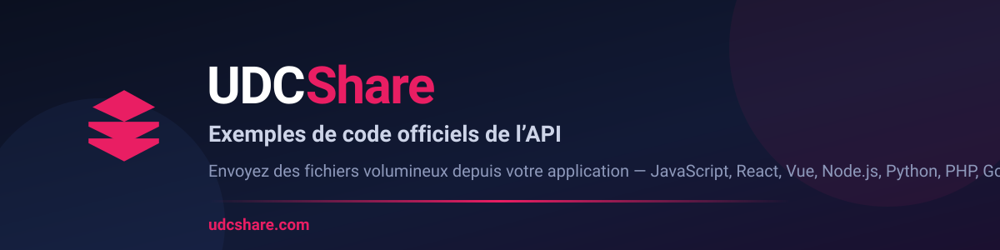

# UDCShare API — Exemples développeurs

**Playground public NOVATECH :** https://novatech-test.udcshare.com.

<p align="center">
  <a href="https://udcshare.com"></a>
</p>

<h1 align="center">Exemples de code officiels de l'API UDCShare</h1>

<p align="center">
  Envoyez des fichiers volumineux depuis votre application, en quelques lignes de code.<br>
  <strong>Node.js · Python · PHP · Go</strong>
</p>

<p align="center">
  <a href="https://udcshare.com"></a>
  <a href="https://udcshare.com/api/docs"></a>
  <a href="LICENSE"></a>
</p>

---

## Qu'est-ce que UDCShare ?

**[UDCShare](https://udcshare.com)** est un service de partage de fichiers volumineux pour les
particuliers, les étudiants et les professionnels. Vous connectez votre propre Google Drive :
vos fichiers restent chez vous, UDCShare se charge du lien, de l'expiration, du mot de passe,
des notifications et du suivi des téléchargements. Le service est proposé sans publicité.

L'**API REST** permet d'intégrer tout cela dans votre propre application : votre produit SaaS,
votre intranet, votre script de sauvegarde ou votre site web.

| | |
|---|---|
| 🌐 **Site** | [udcshare.com](https://udcshare.com) |
| 📘 **Documentation interactive** | [udcshare.com/api/docs](https://udcshare.com/api/docs) |
| 🧪 **Exemples en ligne** | [udcshare.com/examples/](https://udcshare.com/examples/) |
| 🔑 **Obtenir une clé API** | [Tableau de bord → Développeur](https://udcshare.com/dashboard?tab=developer) |
| 📄 **Spécification OpenAPI 3.0** | [udcshare.com/api/openapi.json](https://udcshare.com/api/openapi.json) |
| 📦 **SDK JavaScript backend (Node.js uniquement)** | [udcshare.com/sdk/udcshare-sdk.js](https://udcshare.com/sdk/udcshare-sdk.js) |

---

## Démarrer en une minute

Toutes les requêtes portent votre clé API dans l'en-tête **`X-API-Key`**
(et non `Authorization: Bearer`).

```bash
curl https://udcshare.com/api/v1/usage \
  -H "X-API-Key: VOTRE_CLE_API"

curl https://udcshare.com/api/v1/stats \
  -H "X-API-Key: VOTRE_CLE_API"

> **Gardez la clé côté serveur.** Ne la placez jamais dans du code livré au navigateur, dans une variable publique ou dans un dépôt Git. Les interfaces HTML, JavaScript, React, Vue et Angular appellent votre propre backend relais. Le SDK JavaScript UDCShare est réservé à Node.js côté serveur.

---

## Portails de démonstration complets

| Portail | Architecture | Description |
|---|---|---|
| [NOVATECH Developer Playground](./portals/novatech-demo-portal/) | Site statique + API Node.js + Supabase Auth | Laboratoire public : chaque développeur crée son compte, saisit sa propre URL API, sa clé et son identifiant de projet, puis teste l’état, les fichiers et l’usage de son API. Clés chiffrées et espaces isolés. |

Le guide [NOVATECH Developer Playground](./portals/novatech-demo-portal/README.md) explique le fonctionnement et la sécurité des comptes publics. Consultez aussi le [tutoriel technique en français](./docs/NOVATECH_PLAYGROUND_GUIDE_FR.md) et le [script SQL autonome](./database/novatech-public-demo.sql), limité aux trois tables du Playground et non à la base complète UDCShare. Utilisez un projet Sandbox ou un projet dont vous êtes propriétaire.

---

## Les exemples

Quatre exemples serveur contiennent du code source complet, commenté et prêt à adapter.
Chaque dossier a son propre `README.md`, son `.env.example` et ses dépendances.

### Côté serveur

| Langage | Exemple | Ce que vous obtenez |
|---|---|---|
| **Node.js** | [`nodejs-upload-api/`](./nodejs-upload-api/) | API Express qui relaie les envois en gardant la clé côté serveur |
| **Python** | [`python-backup-system/`](./python-backup-system/) | Sauvegarde planifiée avec journalisation, SQLite et reprise sur erreur |
| **PHP 8** | [`php-upload-service/`](./php-upload-service/) | Classe `Client` compatible Composer, intégrable à Laravel ou Symfony |
| **Go 1.21+** | [`go-backup-service/`](./go-backup-service/) | Paquet `udcshare` et service de sauvegarde concurrent |

## Installation

```bash
git clone https://github.com/SALEMEDO/udcshare-api-examples.git
cd udcshare-api-examples/python-backup-system    # ou l'exemple de votre choix
cp .env.example .env                              # puis renseignez UDCSHARE_API_KEY
```

Les dépendances s'installent avec l'outil habituel du langage : `pip install -r requirements.txt`,
`npm install`, `composer install` ou `go mod download`. Le README de chaque dossier donne la
commande exacte et la façon de lancer l'exemple.

---

## Tarifs UDCShare — offres Web

Les prix ci-dessous correspondent au catalogue actuel de l’application UDCShare. Les forfaits Web sont facturés pour **30 jours**. Le prix de référence est en USD ; le montant en CDF est calculé au taux BCC au moment du paiement.

| Formule Web | Prix / 30 jours | Taille max. par fichier | Volume mensuel | Envois / mois | Drives connectés |
|---|---:|---:|---:|---:|---:|
| Free | Gratuit | 2 Go | 15 Go | 10 | 1 |
| Essentials | 4 USD | 10 Go | 75 Go | 50 | 3 |
| Pro | 9 USD | 100 Go | 750 Go | 100 | 10 |
| Business | 25 USD | 1 To | 5 To | 1 000 | Selon configuration |

Les limites hebdomadaires et journalières supplémentaires sont appliquées dans l’application. Les fichiers sont stockés sur le Google Drive connecté au compte.

## Tarifs Developer Console et API UDCShare

**L’API développeur possède son propre abonnement.** Les formules Web Free, Essentials, Pro et Business ne donnent pas à elles seules accès à l’API. Un seul abonnement Developer Console comprend la console, les organisations, les projets, les clés API, les quotas API et les webhooks. Il n’existe pas de deuxième abonnement API à acheter.

| Offre développeur | Prix / 30 jours | Organisations | Projets au total (max./organisation) | Fichiers API / mois | Taille max. / fichier | Requêtes / min | Clés API | Webhooks |
|---|---:|---:|---:|---:|---:|---:|---:|---:|
| Sandbox | Gratuit, sans échéance | 1 | 2 (2) | 10 | 200 Mo | 30 | 1 | 0 |
| Starter | 9 USD | 2 | 10 (5) | 1 500 | 10 Go | 120 | 3 | 3 |
| Growth | 29 USD | 5 | 30 (10) | 10 000 | 50 Go | 300 | 10 | 10 |
| Scale | 99 USD | 10 | 100 (25) | 60 000 | 100 Go | 900 | 25 | 25 |

Les offres Starter, Growth et Scale durent 30 jours. Sandbox est gratuit et sans échéance. Le passage en Production nécessite également l’approbation technique du projet par UDCShare.

### Utiliser l’API UDCShare avec Zapier

La documentation explique comment connecter Zapier à l’API UDCShare à l’aide d’une clé API transmise dans l’en-tête `X-API-Key`. Les appels effectués depuis Zapier sont comptabilisés dans les quotas de l’offre Developer Console active. Aucun supplément UDCShare ni abonnement API distinct n’est ajouté pour cette connexion. L’abonnement Zapier éventuellement requis est facturé séparément par Zapier et n’est pas inclus dans les tarifs UDCShare.

> Les clés API sont des secrets : conservez-les côté serveur ou dans une connexion sécurisée Zapier. Ne les publiez jamais dans un dépôt Git ni dans du code exécuté dans le navigateur.

Tarifs et conditions à jour : **[udcshare.com/pricing](https://udcshare.com/pricing)** et [Developer Console](https://udcshare.com/developers/dashboard).

---

## Support et contribution

- **Support technique** : [support@udcshare.com](mailto:support@udcshare.com)
- **Signaler un problème dans un exemple** :
  [ouvrir une issue](https://github.com/SALEMEDO/udcshare-api-examples/issues)
- **Proposer un exemple** : les pull requests sont bienvenues, voir
  [CONTRIBUTING.md](./CONTRIBUTING.md)

Ces exemples sont fournis **sous licence MIT** ([LICENSE](./LICENSE)) : utilisez-les, modifiez-les
et redistribuez-les librement, y compris dans un projet commercial. Vérifiez la gestion des
erreurs et des secrets avant une mise en production.

---

<p align="center">
  <a href="https://udcshare.com"></a>
</p>
<p align="center">
  <strong><a href="https://udcshare.com">UDCShare</a></strong> — partagez vos gros fichiers, gardez vos données chez vous.
</p>
